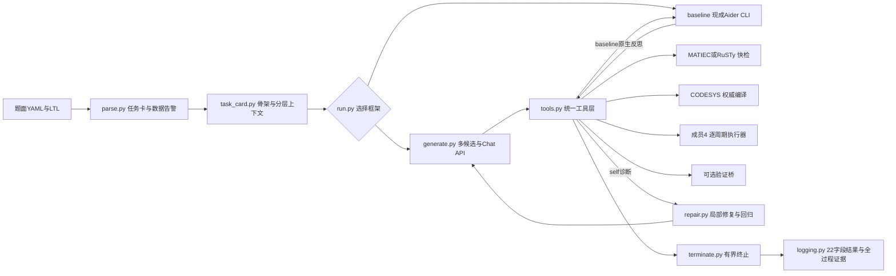
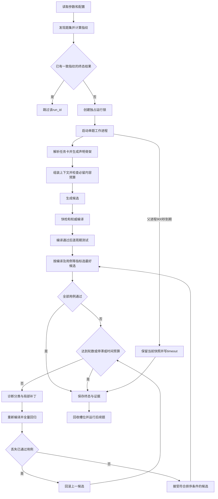

# 自研Agent框架与交接说明

本文对应成员2 v1.1 的 D2.6。源码路径相对仓库根目录，历史验收记录随原始交付快照保存。见[报告第3章](report/ch3.md)、[工具接入说明](toolchain.md)和[原始交付快照](../release/member2-v1.1)。

## 1. 架构、输入与五项能力

| 课程能力 | 实现与证据 |
| --- | --- |
| 任务组织 | `parse_task`生成`task_card.json`；`run.py`将题号、设置、重复次数、seed组成run_id，逐题隔离运行 |
| 上下文管理 | `build_context`保留题面、I/O、初态、约束和完整LTL，优先删除参考，必要时再删反馈；`context_trace.json`记录原因 |
| 工具调用 | `Toolchain.compile/test/verify`使用统一命令桥，保存输入、标准输出、标准错误和结构化结果 |
| 编译与修复 | `feedback`提供诊断及行号附近片段；`apply_patch`应用唯一匹配的增量替换；`regresses`检查已通过用例集合 |
| 终止条件 | 最多5轮、连续2轮无改进、单题900秒、总预算上限；父进程实施超时并终止工作进程树 |

仓库根目录使用成员1的 v1.7 题集。四组正式实验统一显式传入 `--task-set all34`，包含 P01–P20 和 S01–S14。入口仍支持原有的 `core32` 选项，供复现早期批次。原始交付快照保留了 v1.6 题集。

解析器同时保留原始`io_table`及可声明的`interface_io_table`。P07/P17结构字段、P08数组成员路径依据题面显式信息投影为TYPE声明；开放数组、VARIANT、LTIME保留原类型并标注方言要求。骨架为FUNCTION_BLOCK，不含臆测的自然语言初值赋值；`skeleton_compiled=false`是解析初态；独立实测已有33/34骨架生成目标代码，见docs/codesys_validation.md。

已定位的P08/P14/P17/P19需求、接口或规约冲突会产生`semantic_warnings`，并令任务降级。live模式默认停止该题；`--allow-degraded`只允许带告警试跑，相关结果仍不能自动进入正式统计。应先由成员1和成员4统一题意并更新冻结哈希，再重新运行。字段可解析与题意可判定是两项独立验收。

## 2. 执行、选择、修复与终止

自研默认生成3候选，上限5。题干策略分别关注直接实现、边界与联锁、初态与状态；温度列表为0.2/0.6/0.9。DMXAPI所选模型是否接受temperature和seed尚未知，默认不发送这两个可选参数；启用前须核对模型能力并冻结配置，默认候选差异来自提示策略。排序先保留编译通过者，再比较通过用例数、较少修复轮数、较低token消耗。

修复输出为JSON局部替换列表，old必须在当前源码中唯一匹配；空目标、重复目标、过大替换、超过12处修改会被拒绝。每轮保存diff与评估。初选候选使用前述三级排序；修复进展另外比较编译状态、通过用例数及错误数量，以便保留错误减少的中间补丁。编译由pass退化或已通过用例ID集合减少即回滚。没有功能执行器或用例ID不稳定时，不能据此证明“修复没有回归”；成员4必须提供稳定的用例ID。

| 终态 | 判据及示例原因 |
| --- | --- |
| `passed` | 权威编译通过，功能用例数大于0，全部用例通过 |
| `best-effort:<reason>` | 有可编译产物，但功能未全过、缺测试或其他限制；如`test_fail`、`tests_missing`、`budget` |
| `abandoned:<reason>` | 无可接受产物或发生超时/工具问题；如`compile_fail`、`timeout`、`tool_error` |

正式记录的`compile_status`沿用pass/fail/timeout三态。工具故障另在metadata的failure_reason及标准化诊断中区分，统计时先排除工具故障和非正式样本，不可只按compile_status计算模型失败率。可选验证未配置则skipped。

## 3. 证据、续跑与交接边界

每题目录包含任务卡、骨架、候选及最终ST、编译/测试输入输出、API响应缓存、逐轮评估、修复diff、events.jsonl、context_trace.json、metadata.json、manifest.json、result.json和run.jsonl。`result.json`与`run.jsonl`严格保留任务书22字段；过程信息单独保存。批量`runs.jsonl`从每题终态重建，避免续跑重复追加。

6000 token是上下文预设，采用ASCII每3字符、非ASCII每字符2 token的离线估算，并为固定提示等内容留余量。它不是所选模型分词器计数，也不是服务商账单；真实usage缺失时tokens_in/out为null。必留内容超限则以budget停止，不截断需求。total_token_budget是本地保守预算门槛，不能作为精确费用上限。精确成本需成员3使用服务商usage与冻结单价另算。

完成请求按请求内容哈希缓存。发送前写pending标记，成功保存响应后清除；进程崩溃或网络中断留下pending时，默认停止为uncertain_request，不自动重发。确认远端请求状态后才可显式使用`--retry-uncertain`；该选项可能产生额外费用。Aider自身可能有重试行为，应记录实际版本与provider策略，不能把自研防重复机制的保证套到第三方内部。

manifest指纹包括题面、规约、参数、模型、seed、源码和用例目录摘要；同run_id指纹改变即拒绝复用，使用新输出目录重跑。它不证明编译器二进制、设备、库或远端模型版本完全相同，正式实验仍须在环境表冻结这些信息。独占锁防止同目录同时运行；异常退出遗留`running.lock`时，先读取锁中PID，核实该进程及其子进程均已退出，再删除该题锁并续跑，不得盲目批量删锁。

seed记录了实验标识；默认不发送API seed。即使开启seed，远端模型、网关和编译环境也可能引入不确定性，“相同seed必然一致”尚未经真实复跑验证。

`--mode fixture`在独立fixture目录运行可控演示，不调用模型、不使用真实PLC编译器，metadata明确`eligible_for_experiments=false`。它用于验证解析、选择、修复、超时与落盘；不能满足D2.5五题真实日志或正式编译验收。本机CODESYS profile已接通，继续提供DMXAPI准确模型ID/Key和成员4测试桥后，补跑至少5题含失败题并留真实证据。

交给成员3：统一入口、core32/all34口径、22字段schema和示例；交给成员4：final.st、task_card.json、稳定用例ID协议、缺陷轮次与diff；交给成员5：README、环境表、工具接通文档、依赖及打包清单。未完成验收项见`docs/requirements_audit.md`。
